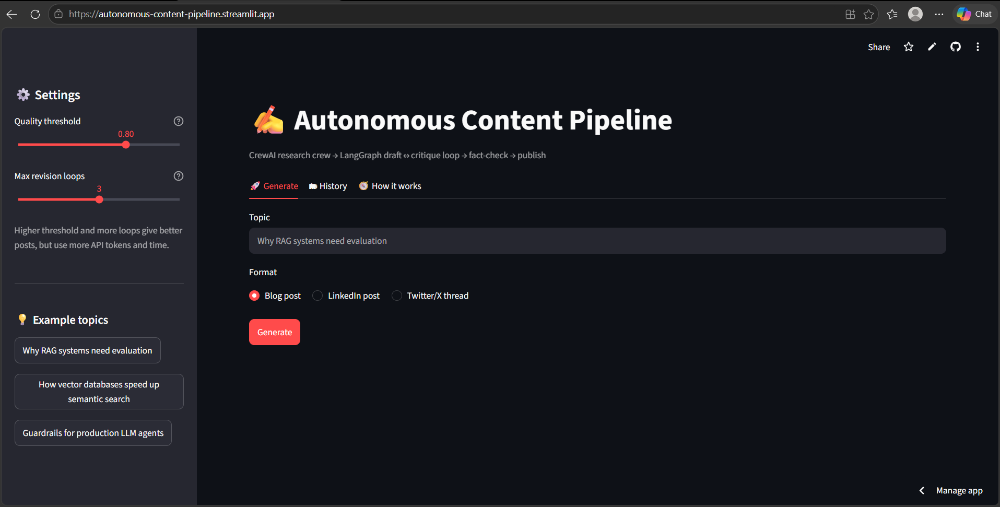

# autonomous-content-pipeline

A multi-agent system that turns a topic into a researched, reviewed post. A **CrewAI** research crew gathers sources, then a **LangGraph** loop drafts, critiques and revises the post until it passes a quality gate (or hits a hard loop cap). It can write a blog post, a LinkedIn post or a Twitter/X thread.



## How it works


1. **Research (CrewAI).** Three agents (librarian, analyst, writer) search the web and write a research brief with source URLs.
2. **Fetch.** The pages named in the brief are downloaded so claims can be checked against them.
3. **Draft.** The writer produces a post in the chosen format (blog, LinkedIn, thread) using only the brief.
4. **Critique.** An LLM critic lists problems and scores traceability, tone and structure. On top of that, code-based checks cap the score for:
   - percentages that do not appear in the research brief
   - percentages not found in any fetched source page (only when at least half of the sources were fetched)
   - format violations (tables or headers in LinkedIn posts, tweets over 280 characters)
   - posts that are too long
5. **Loop.** If the score is below the threshold (default 0.8) and fewer than 3 loops have run, the feedback goes back to the draft step.
6. **Publish.** The best-scoring draft across all loops is saved as Markdown. If it never reached the threshold it is saved with a `FLAGGED` note for human review.

## Features

- Three output formats from the same research
- Bounded revision loop (threshold and max loops are configurable in the app)
- Best-draft selection, so a worse late revision never overwrites a better earlier one
- Code-based checks that catch what the LLM critic misses
- Retry with wait on per-minute rate limits, and a clear message on daily quota limits
- Streamlit app: live pipeline progress, draft-version comparison, score and word-count charts, critic feedback per loop, history tab
- Resumable evaluation script that writes one CSV row per topic

## Setup

```bash
git clone https://github.com/gauravmanjhi09/autonomous-content-pipeline.git
cd autonomous-content-pipeline
python -m venv venv
venv\Scripts\activate        # Windows
# source venv/bin/activate   # Mac/Linux
pip install -r requirements.txt
```

Copy `.env.example` to `.env` and add your [Groq](https://console.groq.com) API key:

```
GROQ_API_KEY=your_key_here
GROQ_MODEL=openai/gpt-oss-120b
```

Run from the project folder:

```bash
cd system-03-content-pipeline

python main.py "Why RAG systems need evaluation"   # one run from the terminal
streamlit run app.py                                # web app
python eval_run.py                                  # evaluation over 10 topics
python eval_run.py --summary                        # print the summary of finished runs
```

`tools`: `list_models.py` lists the models your Groq key can access, which is useful when a model is renamed or retired.

## Evaluation

I ran the pipeline once on each of 10 AI/ML topics (blog format) and logged the result of each run in [`eval_results.csv`](system-03-content-pipeline/eval_results.csv). Model: `openai/gpt-oss-20b` on Groq's free tier. Scores are the **LLM critic's scores plus the code-based caps**, not human ratings.

| Topic | First score | Final score | Loops | Passed |
|---|---|---|---|---|
| Why RAG systems need evaluation | 0.63 | 0.87 | 3 | Yes |
| How vector databases speed up semantic search | 0.60 | 0.83 | 2 | Yes |
| Guardrails for production LLM agents | 0.67 | 0.75 | 3 | No |
| Prompt caching and why it cuts LLM costs | 0.47 | 0.73 | 3 | No |
| Fine-tuning vs retrieval: when to use which | 0.83 | 0.83 | 1 | Yes |
| How embeddings represent meaning | 0.68 | 0.97 | 2 | Yes |
| Why LLM agents need structured outputs | 0.67 | 0.70 | 3 | No |
| Chunking strategies for RAG pipelines | 0.67 | 0.70 | 3 | No |
| Monitoring LLM applications in production | 0.60 | 1.00 | 3 | Yes |
| Reducing hallucinations in LLM apps | 0.67 | 0.73 | 3 | No |

| Metric | Result |
|---|---|
| Passed the quality gate (no human flag) | 5 of 10 |
| Average critic score, first draft | 0.65 |
| Average critic score, final draft | 0.81 |
| Average revision loops | 2.6 |
| Average words per post | 522 |
| Average time per run | 137 s |

Notes on these numbers:

- The final score was never lower than the first score, so the loop helped on every topic. It improved the *critic's score*, which is not the same as improving quality for a human reader.
- The first 7 rows were run before two fixes (retrying research that returns no sources, and rounding scores so 0.7999 is not flagged as below 0.80). The last 3 ran after them. One earlier row, which had run with no research sources, was deleted and re-run.
- This is a small sample with one run per topic, so treat the pass rate as a rough indication, not a reliable estimate.

## What broke and how I fixed it

| Problem | What I found | Fix |
|---|---|---|
| Groq model name returned 404 | The hard-coded model was no longer available on my key | `list_models.py` to list what the key can access; model name now comes from `GROQ_MODEL` in `.env` |
| Critic crashed with `tool_use_failed` | `with_structured_output` made the model call a tool, and it answered in plain text instead | Ask for plain JSON and parse it myself, with 3 retries and a fallback |
| Rate limit errors | Groq's free tier limits tokens per minute | Retry with increasing waits; daily-quota errors stop with a clear message instead of retrying |
| Critic was too lenient | It gave 0.90 to a draft while listing 7 problems | Code-based checks that cap the score (unsupported figures, length, format) |
| Revision loop made posts worse | Word count grew 616 → 738 and issues rose 10 → 18 | Send only the top 6 feedback items, add a hard word limit, forbid adding sections |
| Writer ignored the length target | Drafts were 650+ words for a 500-word target | Lowered the target to 400 words with a 500 hard limit |
| Made-up statistics | The first draft contained figures such as "73%" with no support | Check every percentage against the research brief and against fetched source pages |
| Source pages would not download | `urllib` failed on several sites | Switched to `requests` with a browser User-Agent; fetched 4–6 of 5–6 pages afterwards |
| Fact-check blocked everything | With 1 of 5 pages fetched, any unmatched figure capped the score below the pass mark | The source check only applies when at least half the pages were fetched |
| Best draft not published | The last draft was published even when an earlier one scored higher | The best-scoring draft is tracked and published |
| A 0.80 score was flagged | A floating-point value just below 0.80 failed the threshold check | Round scores to 2 decimals |
| Run with no research | Small model failed in the research crew; the draft was written with 0 sources | Retry research up to 3 times and fail clearly if there are no usable URLs |

## Limitations

- **The critic is an LLM and it is noisy.** On the same topic I saw scores range from 0.63 to 0.93 across runs. Writer and critic use the same model, so the critic can be generous or wrong.
- **The scores are not human ratings.** I did not compare the critic's scores with human judgement.
- **The fact-check covers percentages only.** It does not check paper titles, names, dates or other claims. Fabricated URLs were seen in the research step (some returned 404), and a number not found on a fetched page is "unconfirmed", not necessarily wrong. Most posts in the evaluation contained no percentages at all, so this check was exercised on few of them.
- **Some sources cannot be fetched** (paywalls, bot blocking, JavaScript-only pages). When coverage is low the source check is skipped for scoring.
- **Small evaluation.** 10 topics, one run each, one model, no baseline system to compare against.
- **Free-tier limits.** A full run uses many tokens, and Groq's daily quota can stop a run midway. The evaluation script is resumable for this reason.
- **Verify before publishing.** Treat the output as a draft: check any statistic or paper reference yourself.

## Project structure

```
.
├── .env.example
├── requirements.txt
└── system-03-content-pipeline/
    ├── crew_node.py       # CrewAI research crew + web search tool
    ├── graph.py           # LangGraph pipeline, critic, code-based checks
    ├── main.py            # command-line entry point
    ├── app.py             # Streamlit app
    ├── eval_run.py        # resumable evaluation script
    ├── eval_results.csv   # results of the 10-topic evaluation
    └── list_models.py     # lists models available to your Groq key
```

## Tech stack

Python, LangGraph, CrewAI, Groq (`openai/gpt-oss` models), Streamlit, pandas, requests

## Credits

The overall design (research crew, then a draft-critique loop with an exit condition) started from the "3 Multi-Agent Systems" build guide by @dipanshu.decoded. The quality checks, evaluation script, Streamlit app and the fixes above were built on top of it.
